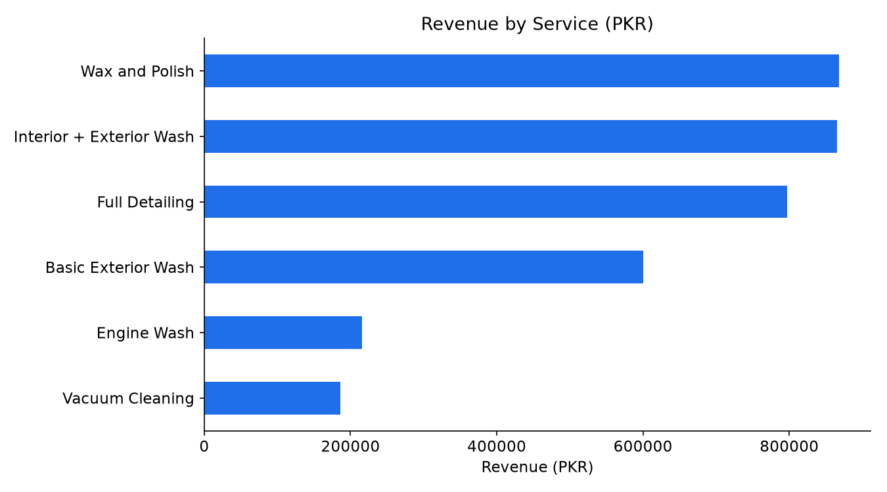
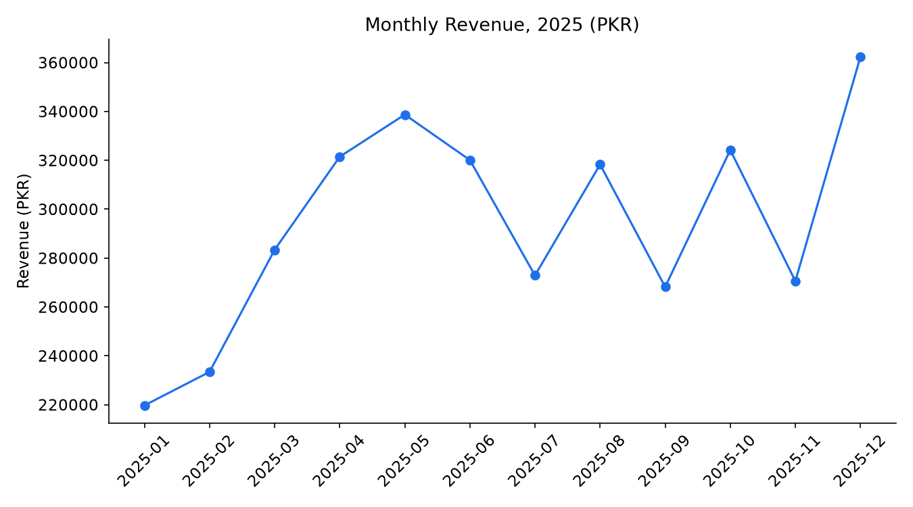
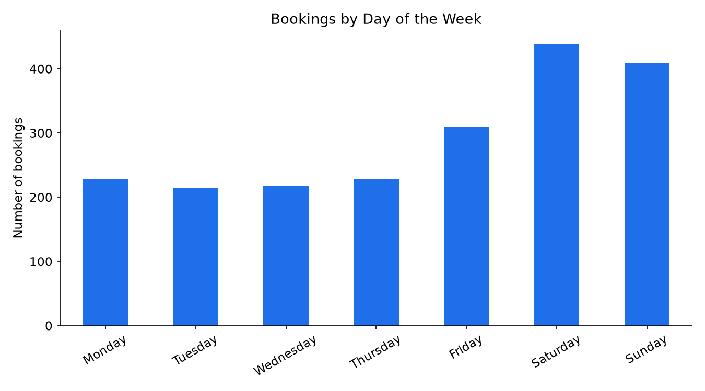
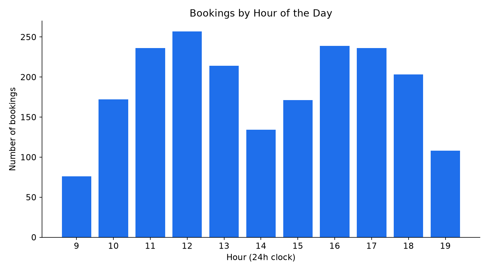
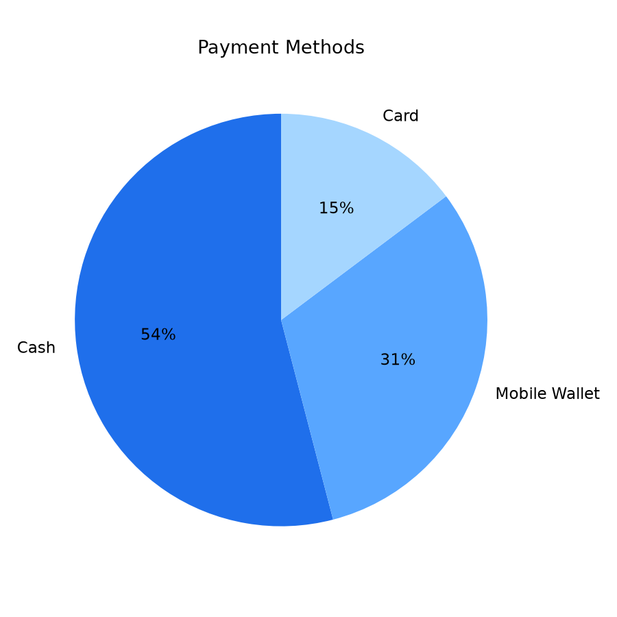

# Car Wash Business Analysis (Python + SQL)

A data analysis project on a sample dataset of car wash bookings. It answers practical business questions: which services earn the most, which days and hours are busiest, how revenue changes across the year, and which washing point performs best.

# **Note on the data:
The dataset is made-up and created with `generate_data.py` for practice. It is not real customer or business data. It is my summer vacation project which completed now. It is a Car Wash Management System.

## Questions answered
1. Which services bring in the most revenue?
2. Which months, weekdays and hours are the busiest?
3. Which washing point earns the most?
4. Which services get the best customer ratings?
5. How do customers pay?

## Tools
- *Python:* numpy (reading files), os (creating directories), pandas (cleaning and analysis), matplotlib (charts)
- *SQL:* SQLite queries (see `queries.sql`)

## Project structure

car-wash-data-analysis/
├── data/car_wash_bookings.csv   # sample dataset (2,061 rows before cleaning)
├── generate_data.py             # creates the sample dataset
├── analysis.py                  # cleaning, key numbers, charts, SQL queries
├── queries.sql                  # 6 SQL queries
├── charts/                      # 5 charts (PNG)
├── cleaned_car_wash_booking.csv # creates cleaned dataset
└── requirements.txt

## Data cleaning
- Removed **15 duplicate bookings** (2,061 rows to 2,046 rows)
- Fixed inconsistent text in `payment_method` (for example `CASH` to `Cash`)
- Converted `date` to a real date and added `month` and `weekday` columns
- **82 ratings were missing.** I left them empty instead of guessing, and ignored them when averaging

## Key findings (on the sample data)
- **Total:** 2,046 bookings and **PKR 3,533,250** revenue. Average booking value is about PKR 1,727.
- **Wax and Polish** earns the most revenue (about 25%), followed closely by **Interior + Exterior Wash**.
- **Full Detailing** is only about 7% of bookings but brings in about 23% of revenue, so premium services are very valuable.
- **Saturday** is the busiest day (438 bookings), and **12:00 noon** is the peak hour.
- Revenue is highest in **December**, with a strong spring peak in **April and May**, and lowest in **January**.
- **Main Boulevard** earns the most revenue. **Satyana Road** earns the least (about 25% of total).
- **Wax and Polish** and **Full Detailing** have the best ratings (about 4.4). Other services are about 4.0.
- **Cash** is the most used payment method (54%).

## Charts
### Revenue by service

### Monthly revenue

### Bookings by weekday

### Bookings by hour

### Payment methods

## Business suggestions (based on this sample data)
- Promote premium services (Wax and Polish, Full Detailing) since they bring high revenue per booking.
- Offer weekday discounts to fill quieter days, and add staff on Saturdays and around noon.
- Look at why Satyana Road earns less (location, marketing, pricing).
- Prepare for the spring and December demand peaks.

## What I learned
Cleaning real-looking messy data with pandas, grouping and summarizing data, writing SQL queries with `GROUP BY` and `ORDER BY`, and presenting findings with charts.

## About this project
A learning project to practise Python and SQL, created with the help of online courses and AI tools.

## Author
Abdul Hanan, BSAI Student
